# How it works

One prompt, one forward pass, then physics. No text is generated anywhere in the path.



## The six steps

**1. One formatted prompt.** The state, the question and every candidate answer are written into
a single sequence:

```
Observation: {state} Measurement ({type}): {instructions} Possible outcomes: * {option 1} * {option 2} Outcome:
```

The option text is part of the model's input, not metadata kept outside it. There is no system
prompt, no chat template and no demonstrations.

**2. One forward pass.** The frozen language model (the reader) runs once over that sequence.
vega pools different token spans from the same hidden states: the situation, the question, one
span per answer option, and the final token.

**3. The input becomes a particle.** The situation vector, the question and the final token place
a particle at a position with a momentum in a 64-dimensional decision space.

**4. Every candidate answer becomes a valley.** Each option's own features produce a well with a
centre, a depth and a width:

```
U(z) = ½κ‖z‖² − Σ_k a_k · exp( −‖z − c_k‖² / 2σ_k² )
```

The quadratic term keeps the particle bounded and each well pulls it toward one answer. Score
levels sit on a one-dimensional rail, so neighbouring scores are physical neighbours.

**5. The particle rolls and settles.** Damped Hamiltonian dynamics for a fixed, small number of
steps, with early exit once it has settled. A decision is a short simulation with constant cost,
not a sampling loop, so it is deterministic.

**6. Where it settles is the answer.**

```
E_k = ‖z_T − c_k‖² / 2σ_k² − log a_k            P = softmax(−E / τ)
```

## Abstain and unbound

- **`abstain`**: the engine declines to commit. Its threshold is calibrated so that, among the
  answers it does give, the error rate stays under the configured risk (10% by default).
- **`prediction_set`**: the conformal set, every option the answer could still be at `alpha`
  0.10. One option means it is sure; two or more means the input really is ambiguous.
- **`unbound`**: the particle settled far from every well, so the input looks unlike anything the
  engine knows. It is reported on every answer, but on its own it is a weak signal: measured, it
  also fired on 71% of normal banking77 rows. Route on `abstain` and the set, or on a fitted
  [band](escalation.md).

## One engine, any reader

The engine lives in a shared 1024-dimensional space that no single language model owns. A reader
connects to it through a small linear port, so the same 14.3M engine, byte for byte, works behind
readers from 0.8B to 27B, and `vegaml.attach()` connects your own. See [vega-U](vega-u.md).

## Two ways to answer

- The **engine** answers any question zero-shot, including options it has never seen, with the
  calibrated probability and the flags above.
- A **head** fitted on your labelled examples is sharper where your labels match the examples,
  and has no abstain flag. `mode="auto"` uses a head only where it beats the engine on the same
  rows.

[Continuous learning](learn.md) builds on the second: heads that are refitted as your team
confirms answers, with the engine answering until a head has earned its place.

## The paper

M, N.; M, A. *From Laya to Vega: Open Non-Autoregressive Decision Models with Calibrated
Probabilities.* Preprints 2026, 2026110781.
[doi:10.20944/preprints202611.0781.v1](https://doi.org/10.20944/preprints202611.0781.v1)
